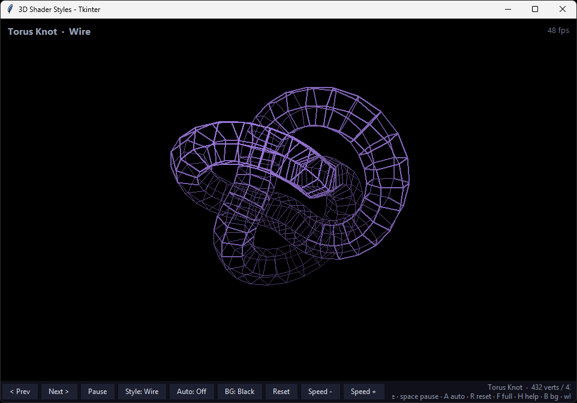

# 3D Shader Styles — Tkinter Wireframe Demo



A dependency-free Python/Tkinter demo that renders ten procedurally generated
3D meshes with five switchable render styles. Written as a first test demo on
NVIDIA DGX Spark.

## Run

Requires Python 3 with Tkinter (bundled with the standard Windows installer).
No third-party packages.

```
python wireframe3d.py
```

## Controls

| Input                   | Action                              |
| ----------------------- | ----------------------------------- |
| `←` / `→`               | Switch shape                        |
| `1`–`5` or `M`          | Render style (Wire, Solid, Chrome, Toon, Ghost) |
| `Space`                 | Pause / resume                      |
| `A`                     | Auto-cycle shapes every 8 s         |
| `+` / `−`               | Spin speed                          |
| Mouse wheel             | Zoom                                |
| Drag                    | Rotate (with inertia)               |
| `R`                     | Reset view                          |
| `F`                     | Fullscreen                          |
| `H`                     | Help overlay                        |
| `Esc`                   | Quit                                |

The toolbar buttons mirror most of these (Prev/Next, Pause, Style, Auto,
Reset, Speed −/+).

## Shapes

Cube, tetrahedron, octahedron, icosahedron, dodecahedron, sphere, torus,
torus knot, Möbius strip, and spring — all generated procedurally at startup.

## Render styles

- **Wire** — depth-shaded edges with vertex dots
- **Solid** — two-light shading with rim light and specular highlights
- **Chrome** — sky/ground reflection gradient
- **Toon** — cel-shaded bands with dark outlines
- **Ghost** — translucent fill with depth-shaded glowing outlines

## Implementation notes

- Faces are extracted from vertex/edge data by angularly sorting each
  vertex's neighbors, walking minimum cycles with a step cap, then
  orienting them consistently via BFS across shared edges plus a
  signed-volume flip. Topology is verified against Euler characteristics
  and analytic volumes for the regular solids.
- Filled styles use painter's-algorithm depth sorting and backface culling;
  polygons of any size (triangles, quads, pentagons) are supported.
- Each frame redraws only its tag-scoped canvas items over a persistent
  baked background (gradient bands, starfield, ground shadows), keeping
  redraw leak-free and fast.
